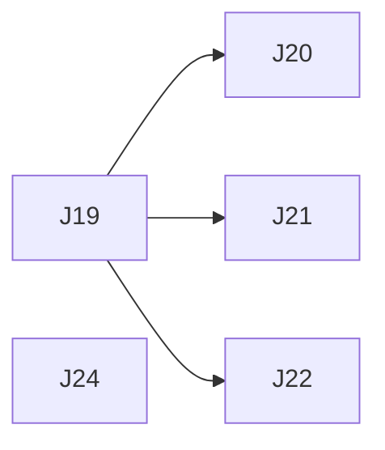

# Glance — Execution Plan

| | |
|---|---|
| Version | v6.2 |
| Date | 2026-10-30 |
| Inputs | [`product-spec.md`](product-spec.md) (v1.46) · [`tech-design.md`](tech-design.md) (v3.38) · design handoff v22 (`Kiosk display mockups.zip`, 2026-10-30) |
| Checks | `npm run check` → `npm run typecheck` → `npm test` → `npm run build` |

The backlog of open work. `/dooo` runs it top to bottom: it takes the first ⬜ row whose dependencies are ✅, does it in one PR, merges it and moves on until every row is ✅.

## Status tracking

| Status | Meaning |
|---|---|
| ⬜ Todo | Not started |
| 🔄 In progress ([#n](#)) | Work has started on its branch. Links the task's PR |
| ✅ Done ([#n](#)) | The task's PR is **merged to the default branch** |

**Rules**
- **Order** is the row order of the Tasks table. Put a task below everything it needs.
- A task is PR-sized (about 0.5–2 days of work), starts with a bold short title (`**Login form**: …`), and has a **Done when** check that can be verified (a test, a command, a page that matches a design).
- **IDs** are a letter and two digits (`A01`), one letter per batch of work. Never reuse an ID. Every letter A–Z is used, so a new batch reuses a letter and continues after its highest number (this batch: J, from J19).
- **Depends on** lists hard dependencies only, by ID, and only on rows still in this file, or `—`. A task can start once they are ✅. Two tasks that edit the same files (beyond the plan, docs and lockfile) also get a dependency, even without a logical one, so they never run at the same time.
- **Dependency map** (below the table) mirrors the Depends on column: a Mermaid graph and the parallel waves. Tasks in one wave have no path between them, so `/dooo` may run them at the same time. Update the map whenever a row or a dependency changes; the table wins if they disagree.
- One task = one branch (`feat/<ID>-<slug>`) and one PR titled `<ID>: <title>`. The PR's first commit sets the row to 🔄; its last commit before merge sets it to ✅. A closed, unmerged PR resets the row to ⬜.
- **Checks** (header) must all pass locally before the PR is marked ready, and CI (if the repo has any) must be green before merge.
- **Docs move with the code:** a PR that changes behavior, a decision, a schema, an API or the structure updates the spec and/or tech design in the same PR and fixes any row it makes wrong.
- Remove ✅ rows once nothing open depends on them.

**Owner decisions for v21** (2026-10-29 interview; they override the handoff where they differ, and the tasks below write them into the spec):
- **API key** reads and writes: `GET` (list, one), `POST`, `PATCH`, `DELETE` on `/api/v1/events` on the app's own host, `Authorization: Bearer glc_live_…`. The handoff's "can't read or list events" copy (Notes, Guide 08, the key panel) becomes read-and-write copy. Glance's event `id` is the handle: `POST` answers with it, `GET` lists it.
- **API reads** return events as stored (a weekly series is one item with `repeat` and `exdates`), filtered by optional `from` / `to` local dates.
- **API `who`** is an optional list of member names (ignoring case); missing = everyone; an unknown name is 400. API events remind like any other event.
- **API rate limit**: 60 requests a minute per key, then 429 with `Retry-After`.
- **Export events** is disabled offline ("Offline · needs a connection"), like Import and API key.
- **App version** is `package.json` `version`; every release bumps it.

## Tasks

| ID | Status | Task | Depends on | Done when | Covers |
|---|---|---|---|---|---|
| J19 | ✅ ([#224](https://github.com/vespaiach/glance/pull/224)) | **Handoff v22 and the Guide and Terms card**: copy the v22 handoff into `docs/design/handoff/` (changed: `Glance.dc.html`, `Glance New Event.dc.html`, `Glance Notes.dc.html`). Guide and Terms of Service leave the bottom of `SettingsPanel` for their own white card (radius 24, 8 px vertical padding) 24 px under the Settings card in the left column (`SettingsView`; on small it follows the Settings card): two rows, min 56 px, hairline between, label 17/540 left and `arrow-up-right` right, each opening `/guide` / `/terms` in a new tab. Ambient screen tile text gets line-height 1.2 (title) / 1.4 (hours). Spec SET-08, SET-15 updated (version bump). Gallery `SettingsGallery` shows the new card in all four seasons | — | `SettingsView.test.tsx` test `SET-15 …` (both links in their own card, `target="_blank"`, hrefs) passes; Settings matches `Glance.dc.html` (Settings) at 1920×1080, 1024×768 and 390×844; Checks pass | SET-08, SET-15 |
| J20 | ✅ ([#226](https://github.com/vespaiach/glance/pull/226)) | **Remove a member as an icon button**: `MemberList`'s secondary "Remove" button becomes a 56 px canvas `IconButton` (`trash-2`, touch size, no text, named "Remove {name}") on the right of the row; the two-tap confirm row, result line and last-member text don't change. Spec FAM-08 updated. Gallery shows the idle and asking rows in all four seasons | J19 | `MemberList.test.tsx` tests `FAM-08 …` (button named "Remove {name}" with no visible text; first tap still asks; last member has none) pass; card matches `Glance States - Settings` (frame R) and `Glance.dc.html` at the three sizes; Checks pass | FAM-08 |
| J21 | ✅ ([#227](https://github.com/vespaiach/glance/pull/227)) | **Compact event top bar on small**: on small (≤ 768) `EventTaskBar` is min 56 px, padding 8 × 12 px, 8 px gap, 20 px title; Back is a 40 px (md) `IconButton`. Delete, Save, Edit and Add another become 40 px icon-only round buttons (`trash-2` canvas; `check` solid, dimmed to 35% while the title is empty; `pencil` canvas; `plus` solid), named by their old label. Delete confirm: × canvas ("Keep") + `trash-2` on danger ("Delete event"). "Discard changes?" keeps text buttons at md. Large and normal unchanged. Spec EVT-05 updated. `EventPageGallery` shows small in every mode | J19 | `EventTaskBar.test.tsx` tests `EVT-05 …` (on small: icon buttons named Delete / Save / Edit / Add another, Save disabled with an empty title, delete confirm names Keep and Delete event, Discard keeps its text) pass; the event page matches `Glance New Event` (`size` small, every `mode`) at 390×844 and is unchanged at 1920×1080 and 1024×768; Checks pass | EVT-05 |
| J22 | ✅ ([#228](https://github.com/vespaiach/glance/pull/228)) | **Keep the focused field above the keyboard**: pure `revealDelta(field, label, viewport)` in `domain/keyboard.ts` returns how far to scroll so the field (with its label when both fit and the label sits at most 48 px above it) has its bottom 16 px above the keyboard and its top at least 12 px below the top of the visible area; 0 when already inside. `useFieldInView` runs it on focus (again 350 ms later) and on every `visualViewport` resize, scrolling the nearest scroll area first (padded by the keyboard height while it's open), then outer ones, then the window; the padding goes when no field has focus. Replaces the "24 px below the top" rule. Spec KB-02, KB-03 updated | J19 | `keyboard.test.ts` tests `KB-03 …` for `revealDelta` (below the keyboard → up to 16 px above it, above the top → down to 12 px, label kept when it fits, dropped when it doesn't, already visible → 0) and `fieldInView` tests (scroll area scrolls first, the rest goes to the window, padding removed on blur) pass; on a phone, focusing the last field of the event page and the Location card keeps it above the keyboard; Checks pass | KB-02, KB-03 |
| J24 | ✅ ([#231](https://github.com/vespaiach/glance/pull/231)) | **Always show the reminder push**: `data/sw/push.ts` `showPush` no longer skips `showNotification` when a Glance window reports `visible`. Safari (iOS) requires every push to show a notification and revokes the subscription after about three that don't; Apple then answers 410 and the reminder job deletes the row, so iPhones stop getting reminders after a few that arrive while Glance is open. A phone with Glance open now shows the strip and the notification. The same-origin `data.url` guard stays. Spec NOTIF-07 and tech design D30 updated | — | `push.test.ts` test `NOTIF-07 shows the notification even when a Glance window is visible` passes; Checks pass | NOTIF-07 |

## Dependency map

| Wave | Tasks (run in parallel) |
|---|---|
| 1 | J19, J24 |
| 2 | J20, J21, J22 |
