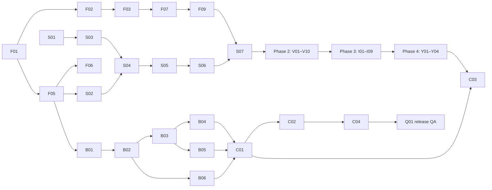

# Glance — Execution Plan

| | |
|---|---|
| Status | v1.2 — branch from latest main · v1.1: task status tracking · v1.0: first plan |
| Date | 2026-10-11 |
| Inputs | [`product-spec.md`](product-spec.md) (v0.8) · [`tech-design.md`](tech-design.md) (v1.3) |

Tasks are PR-sized (about 0.5–2 days). Each one cites the requirement IDs it covers. **Depends on** lists hard dependencies only: a task can start once they are **Done**. Phases follow spec §11. The backend lane (B) depends only on `domain` and can run in parallel with phases 2–4 if there is a second person.

Every task meets its done-when criterion with CI green (`biome check → tsc → Vitest → next build`) and unit tests for its new domain logic.

## Status tracking

| Status | Meaning |
|---|---|
| ⬜ Todo | Not started |
| 🔄 In progress ([#n](#)) | Work has started. Links the task's PR |
| ✅ Done ([#n](#)) | The task's code is **merged to `main`**. Nothing else counts as done |

**Rules**
- One task = one branch and one PR (`feat/F01-scaffold`), titled with the task ID (`F01: scaffold`). A task too big for one PR is split into new rows (`F07a`, `F07b`) before work starts.
- **Start:** `git fetch origin`, then check on `origin/main` that every **Depends on** task is ✅. Branch from the latest `origin/main` (`git switch -c feat/F01-scaffold origin/main`), never from a local or stale `main` or another task's branch. Open the PR as a draft right away. Its first commit sets the row to 🔄 with the PR link.
- **Stay current:** before marking the PR ready and again before merge, bring in the latest `origin/main` and resolve conflicts, including in this plan's status rows.
- **Finish:** the PR's last commit before merge sets the row to ✅. It becomes true when the PR merges. A closed, unmerged PR resets its row to ⬜.
- `main` is the record of what's done. On `main`, a row goes from ⬜ straight to ✅ when its PR merges. 🔄 shows on the task's branch and in its PR, so the list of open PRs is the live view of work in progress.
- A task found along the way gets a new row with the next free ID in its phase, its dependencies and a done-when check.
- **Docs move with the code.** A PR that changes behavior, a decision, a schema, an API or the project structure updates `product-spec.md` and/or `tech-design.md` **in the same PR**: bump the version, add an entry to tech §9 if the spec changed, and fix any task row it makes wrong. A PR whose code disagrees with the docs isn't done.

---

## Dependency overview

**Critical path:** F01 → F02 → F03 → F07 → F09 → S07 → V01 → I01 → Y01 → C01 → C02 → C04 → Q01.

---

## Phase 0 — Foundations

| ID | Status | Task | Depends on | Covers | Done when |
|---|---|---|---|---|---|
| F01 | ✅ ([#4](https://github.com/vespaiach/glance/pull/4)) | **Scaffold.** Next (exact version pinned), TS strict, npm + lockfile, Biome with the dependency rules (`noRestrictedImports`), Vitest + Testing Library + `fake-indexeddb`, CI, npm scripts from CLAUDE.md. **Decide the bundler** (webpack vs Turbopack + Serwist standalone build) | — | D1, D2, D18, tech §3, §4.5 constraints | CI green on an empty app. Bundler decision recorded in tech §4.5 |
| F02 | ✅ ([#5](https://github.com/vespaiach/glance/pull/5)) | **StyleX setup:** `babel.config.js`, `postcss.config.js`, `app/globals.css` with `@stylex;` | F01 | D3, spec §3 | A StyleX-styled page works in `next dev` and `next build` |
| F03 | ✅ ([#6](https://github.com/vespaiach/glance/pull/6)) | **Tokens and seasons:** `tokens.stylex.ts` (colors, space, radii, shadows, motion), `type.stylex.ts` with the `clamp()` values, season `defineVars` + 3 `createTheme`s, Ambient type override | F02 | spec §4.1, §4.3 | Values match the handoff `tokens/*.css` one to one |
| F04 | ✅ ([#8](https://github.com/vespaiach/glance/pull/8)) | **Fonts and icons:** Geist + Geist Mono via `next/font/local` into the type vars. `lucide-react@0.460.0` `Icon` wrapper (stroke rules) | F03 | spec §3, §4.1 | Fine weights (320/330/340/480/540) render. No runtime font requests |
| F05 | ✅ ([#9](https://github.com/vespaiach/glance/pull/9)) | **Domain schemas:** Valibot schemas + types for §7 (`Synced<T>`, events, notes, photos, settings, weather, account), defaults. `copy.ts` skeleton | F01 | spec §7, D6 | Types inferred from schemas. Defaults match spec §7.0 |
| F06 | ✅ ([#10](https://github.com/vespaiach/glance/pull/10)) | **Domain logic** with unit tests: `time.ts` (TIME-01 formats), `eventStatus`, `seasonFor`, `toCelsius`, TPK rules (`nextHalfHour`, end shift, validation), `noteTilt`, `noteExpired`, `pictureOfDay`, `nextNotableDay`, `wmo` mapping, `zoneState` | F05 | STATUS-01, TIME-01, TPK-05..08, NOTE-04/08, TODAY-07, AMB-03, LOAD/FAIL (tech §4.4) | Each rule has table-driven tests, including spec examples (10:41 → 11:00, caps at 11:30 / 11:55 PM) |
| F07 | ✅ ([#11](https://github.com/vespaiach/glance/pull/11)) | **DS primitives:** Eyebrow, Button, IconButton, PillTabs, TextInput, ColorBlock, Card, Banner | F03, F04 | spec §4.2, §4.4 | Props match the DS bundle. Press scale 0.97, no hover states |
| F08 | ✅ ([#12](https://github.com/vespaiach/glance/pull/12)) | **DS display components:** Clock, EventRow, MonthGrid, TopBar, WeatherNow, ForecastDay, StickyNote | F07, F06 | spec §4.2, §5.4 (EventRow phone columns) | Component tests with fixture props |
| F09 | ✅ ([#13](https://github.com/vespaiach/glance/pull/13)) | **Shared pieces:** Skeleton, EmptyState, SourceFailure, Sheet (scrim, focus trap, sticky actions), ColorSwatchPicker, OfflinePill, SettingsRow, `<Zone>` + `ZoneState<T>` | F07 | spec §4.2, SHEET, A11Y | Sheet traps focus and has `role="dialog"`. `<Zone>` renders all 4 states |
| F10 | ✅ ([#14](https://github.com/vespaiach/glance/pull/14)) | **TimeField + TimePicker** (presentational) | F07, F06 | TPK-01..04, TPK-10 | All states from `time=start\|end\|error\|noend` and `clock=24` render. A11y labels per TPK-10 |
| F11 | ✅ ([#15](https://github.com/vespaiach/glance/pull/15)) | **Gallery** `/dev/gallery` (demo builds only, `NEXT_PUBLIC_DEMO`) | F08, F09, F10 | DS-01 | Every component in all 4 seasons. Excluded from the production build |

**Phase 0 exit:** DS-01 passes (screenshot review against the DS cards).

---

## Phase 1 — Shell, data and fixtures

| ID | Status | Task | Depends on | Covers | Done when |
|---|---|---|---|---|---|
| S01 | ✅ ([#16](https://github.com/vespaiach/glance/pull/16)) | **Fixtures:** Appendix A data, bundled photo images, `fixtures/params.ts` (every §6 param + `now=`) | F05 | spec §6, Appendix A | Parser unit-tested. No network images |
| S02 | ✅ ([#17](https://github.com/vespaiach/glance/pull/17)) | **Local store:** `data/db.ts` (Dexie schema per account), `data/meta.ts` (`glance-meta`) | F05 | tech §4.1, §4.5 Gap 2 | Data tests: open, upgrade, delete per account |
| S03 | ✅ ([#18](https://github.com/vespaiach/glance/pull/18)) | **Transport:** `Transport` interface (push, pull, weather, places, auth.\*, upload) + `FixtureTransport` (seeding, mock delays, `net=` and `upload=` / `wx=` / `signin=` modes) | S01, S02 | tech §4.2, spec §11 | Each method has a fixture behavior covering the spec's [Mock] states |
| S04 | ✅ ([#19](https://github.com/vespaiach/glance/pull/19)) | **Sync engine core** `engine.ts` + inline `host.ts`: outbox drain in order, apply with the outbox guard, tombstones, weather refresh + FAIL-03 retry schedule, status in `meta.status`, `Result` errors | S02, S03 | SYNC-02/03, WX-06, tech §4.6, §5 | Engine tests: order, guard on pull **and** push response, delete wins, 400/401/426 paths, weather retry timing |
| S05 | ✅ ([#20](https://github.com/vespaiach/glance/pull/20)) | **Repos + hooks:** events, notes, photos, settings, weather. Row + outbox in one transaction, `nudge()`, derived "Waiting to post", expired notes hidden | S04 | tech §4.2, OFF-04, NOTE-08 | Repo tests: atomic write, derived pending, `useLiveQuery` updates |
| S06 | ✅ ([#21](https://github.com/vespaiach/glance/pull/21)) | **Shell providers:** Now (`?now=`), Settings, Season (theme + midnight re-check), Network (`meta.status`, 30 s pill delay), Idle (timeout, ambient schedule, text-focus pause), SheetHost, `useBreakpoint` | S05, F06 | TIME-02/03, SET-02, IDLE-01..03, AMB-05, OFF-01 timing, spec §5.1 | Provider tests with an injected `now` |
| S07 | ✅ ([#22](https://github.com/vespaiach/glance/pull/22)) | **Routes and shell:** static `(app)` routes, `/signin`, `/ambient`, `/` → `/today` redirect, AppShell + NavBar, client auth gate (`glance-meta` or demo), `layout(view, bp)` per view | S06, F08, F09 | SHELL-01..04, spec §5.2/5.3, §6, tech §4.5 Gap 1 | Every route renders at the 6 board sizes. `next build` reports every route static |
| S08 | ✅ ([#23](https://github.com/vespaiach/glance/pull/23)) | **Web app manifest** + icons | F01 | tech §4.5 Gap 5 | Manifest valid. `start_url` `/today` |

**Phase 1 exit:** every route renders at the 6 sizes from fixture data.

---

## Phase 2 — Screens (static states)

All depend on **S07**. They can run in parallel. Each is checked against its `Glance Frames - *` board at the 6 sizes.

| ID | Status | Task | Extra deps | Covers |
|---|---|---|---|---|
| V01 | 🔄 ([#24](https://github.com/vespaiach/glance/pull/24)) | **Today:** hero states, schedule, picture of the day, weather zone, notes zone, live status changes | — | TODAY-01..11, TIME-02 |
| V02 | ⬜ | **Calendar:** month block, day list, empty states | — | CAL-01..05 (render) |
| V03 | ⬜ | **Event sheet:** New/Edit, fields, swatches, delete confirm, time fields | F10 | EVT-01..06, TPK-01..04 |
| V04 | ⬜ | **Weather:** now, hourly, 7-day, rain banner, setup card + search states | — | WX-01..05, WX-07..09 (states) |
| V05 | ⬜ | **Notes:** board, note sheet, counts and captions | — | NOTE-01..07 |
| V06 | ⬜ | **Photos:** featured, thumbs, empty, upload tile states; upload hidden on phone | — | PHOTO-01, 05..09 (states), spec §5.4 |
| V07 | ⬜ | **Settings + Background:** rows, account card, background picker and preview | — | SET-01..08, BG-01..05 |
| V08 | ⬜ | **Ambient** | — | AMB-01..04 |
| V09 | ⬜ | **Sign in:** all `signin=` states, hero, lock footer; SIGNIN-13 uses the SIGNIN-01 form | — | SIGNIN-01..12 (states), SIGNIN-13 fallback |
| V10 | ⬜ | **Photo background mode** across views | V01, V07 | SHELL-05, BG-06, TODAY-10 |

**Phase 2 exit:** visual parity with every board at the 6 sizes (manual screenshot review, tech §7).

---

## Phase 3 — Interactions (local)

| ID | Status | Task | Depends on | Covers |
|---|---|---|---|---|
| I01 | ⬜ | **Events CRUD:** sheet reducer, validation, TPK defaults and rules, save → repo, Today and Calendar update | V01, V02, V03 | EVT-03..07, TPK-05..09, TODAY-03/04 |
| I02 | ⬜ | **Calendar navigation:** select day, month stepping, `?date=` | V02 | CAL-01..03 |
| I03 | ⬜ | **Notes CRUD:** sheet reducer, Guest author, tilt, delete confirm | V05 | NOTE-01..05, NOTE-09 |
| I04 | ⬜ | **Slideshow:** featured stepping, 8 s timer, play/pause, finished photos only | V06 | PHOTO-01, 02, 07 |
| I05 | ⬜ | **Upload flow:** upload-tile reducer over `transport.upload` (progress, per-file errors, retry, remove), pre-checks | V06, V07 | PHOTO-03, 04, 06, 08, BG-02 |
| I06 | ⬜ | **Settings live:** season cross-fade, clock, unit, idle, note expiry, background modes, slideshow rotation | V07, V10 | SET-02..07, BG-01..06 |
| I07 | ⬜ | **Weather setup:** search reducer, choose place, save `weatherLocation`, refresh | V04 | WX-04, 06..09 |
| I08 | ⬜ | **Idle and Ambient:** return to Today, wake tap, schedule enter/leave, sheets discarded | V08, S06 | IDLE-01..03, AMB-04/05, SHELL-04 |
| I09 | ⬜ | **Sign-in flow:** reducer over `transport.auth` (send, poll 2 s, name step, expired, done → Today), `glance-meta` write, sign-out | V09 | SIGNIN-01..12 |

**Phase 3 exit:** behavior notes reproduced end to end in fixture mode.

---

## Phase 4 — System states

| ID | Status | Task | Depends on | Covers |
|---|---|---|---|---|
| Y01 | ⬜ | **Loading and failure per zone:** skeletons, 10 s timeout, failure + countdown + Try again, "Updated {time}", weather retry schedule | S04, V01..V08 | LOAD-01..03, FAIL-01..03, WX-05 |
| Y02 | ⬜ | **Offline:** pill + saved time, sheet banners, "Save for later", "Waiting to post", forecast-from banner, Ambient notice, upload disabled/paused, sign-in offline | Y01, I01, I03, I05, I09 | OFF-01..05, SHEET offline, WX-03, PHOTO-09, SIGNIN-10 |
| Y03 | ⬜ | **On-screen keyboard:** `visualViewport`, sheet shrink, full-page form padding, Return behavior | V03, V05, V04, V09 | KB-01..04 |
| Y04 | ⬜ | **Accessibility pass:** labels, `aria-pressed`, dialog labels, sheet focus order (proposed default), contrast check | Phase 3 | A11Y, spec §8.9 |

**Phase 4 exit:** `net=loading|offline|wxerror` and `kb=1` match the System states board.

---

## Phase 5 — Real data

### Backend lane (can start after F05)

| ID | Status | Task | Depends on | Covers |
|---|---|---|---|---|
| B01 | ⬜ | **DB and runtime:** `server/env.ts`, connection (WAL, foreign keys), `migrate.ts`, `001_init.sql`, `instrumentation.ts` | F05 | spec §7.0, tech §6.4/6.5, D7 |
| B02 | ⬜ | **Auth:** link (rate limit, `pending_id` cookie, time zone), verify, status, name, signout, `requireDisplay`, Origin check, Nodemailer | B01 | SIGNIN-04..12, tech §6.1/6.2, D11, D14 |
| B03 | ⬜ | **Entity services + routes:** events, notes, settings `PUT`/`DELETE`, version stamping, delete wins, 426 build check, server validation | B02 | SYNC-01/03, tech §5, §6.1 |
| B04 | ⬜ | **Sync routes:** `/api/sync` pull, `server/bus`, `/api/sync/stream` SSE + 25 s heartbeat | B03 | SYNC-02, tech §5 |
| B05 | ⬜ | **Photos:** streamed `POST`, size/type checks, `sharp` variants, EXIF date, file route `?v=` | B03 | PHOTO-04, D12, tech §6.3 |
| B06 | ⬜ | **Weather:** Open-Meteo adapter, per-account cache (15 min), `/api/weather`, `/api/weather/places` | B02 | WX-01..09 data, D13 |
| B07 | ⬜ | **Jobs:** note expiry (account time zone), link cleanup, nightly backup | B03 | NOTE-08, SIGNIN-12, tech §6.4 |

### Client integration

| ID | Status | Task | Depends on | Covers |
|---|---|---|---|---|
| C01 | ⬜ | **HttpTransport:** all methods, XHR upload with progress, build id header, `Result` error mapping | S03, B04, B05, B06 | tech §4.2, §6.3 |
| C02 | ⬜ | **Sync worker:** `sync.worker.ts`, Comlink, `glance-sync` lock, SSE + 30 s polling, backoff, `versionchange` restart, 401/426 handling in the page | C01, S04 | D19, tech §4.6, §5 |
| C03 | ⬜ | **Auth wiring:** real sign-in, `navigator.storage.persist()`, 401 → `/signin` with the outbox kept, account switch deletes the old DB, sign-out cleanup | C01, I09 | SIGNIN-11, SIGNIN-13, tech §4.5 Gaps 2/3/5 |
| C04 | ⬜ | **Service worker:** Serwist precache, navigation/RSC strategies, photo cache + warming, idle update flow | C02, S07 | D16, OFF-06, OFF-07, tech §4.5 |
| C05 | ⬜ | **Deploy:** Docker image (`standalone`, `/data` volume), Caddy notes, backup README | B07 | D17 |

### Release

| ID | Status | Task | Depends on | Covers |
|---|---|---|---|---|
| Q01 | ⬜ | **Manual QA checklist** (tech §7): visual parity, offline cold start on a production build, two screens syncing, 401 and update paths on a kiosk | C03, C04, C05 | OFF-06/07, SYNC-01..03 |

---

## External dependency

| ID | Status | Item | Blocks | Fallback |
|---|---|---|---|---|
| D01 | ⬜ | Design for SIGNIN-13 ([prompt 4](prompts/04-session-ended.md)) | Final SIGNIN-13 screen (follow-up to C03) | SIGNIN-01 form as-is (spec §8.1) |
