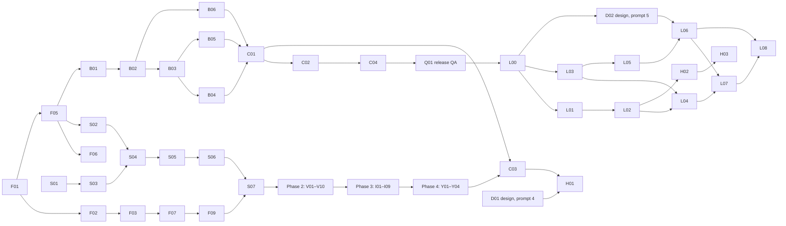

# Glance — Execution Plan

| | |
|---|---|
| Status | v1.5 — doc review of the unbuilt v4 work: L03–L08 and H01–H03 rows follow spec v0.34 / tech design v1.61 (first setup on the server in L08, fixture zones in L04, locate failure names, signed-out boot and Ambient routing in H01, SET-06 summary in H02); L08 depends on L07 · v1.4 — D01/D02 design handoff v4: L04, L06–L08 rows follow it, new Phase 7 (H01–H03: signed-out form, editable ambient schedule) · v1.3 — Phase 6 location and time zone (L00–L08), D02 design for it · v1.2 — branch from latest main · v1.1: task status tracking · v1.0: first plan |
| Date | 2026-10-12 |
| Inputs | [`product-spec.md`](product-spec.md) (v0.34) · [`tech-design.md`](tech-design.md) (v1.61) |

Tasks are PR-sized (about 0.5–2 days). Each one cites the requirement IDs it covers. **Depends on** lists hard dependencies only: a task can start once they are **Done**. Phases follow spec §11. The backend lane (B) depends only on `domain` and can run in parallel with phases 2–4 if there is a second person.

Every task meets its done-when criterion with CI green (`biome check → tsc → Vitest → next build`) and unit tests for its new domain logic.

## Status tracking

| Status | Meaning |
|---|---|
| ⬜ Todo | Not started |
| 🔄 In progress ([#n](#)) | Work has started. Links the task's PR |
| ✅ Done ([#n](#)) | The task's code is **merged to `main`**. Nothing else counts as done |

**Rules**
- One task = one branch and one PR (`feat/F01-scaffold`), titled with the task ID (`F01: scaffold`). A task too big for one PR is split into new rows (`F07a`, `F07b`) before work starts.
- **Start:** `git fetch origin`, then check on `origin/main` that every **Depends on** task is ✅. Branch from the latest `origin/main` (`git switch -c feat/F01-scaffold origin/main`), never from a local or stale `main` or another task's branch. Open the PR as a draft right away. Its first commit sets the row to 🔄 with the PR link.
- **Stay current:** before marking the PR ready and again before merge, bring in the latest `origin/main` and resolve conflicts, including in this plan's status rows.
- **Finish:** the PR's last commit before merge sets the row to ✅. It becomes true when the PR merges. A closed, unmerged PR resets its row to ⬜.
- `main` is the record of what's done. On `main`, a row goes from ⬜ straight to ✅ when its PR merges. 🔄 shows on the task's branch and in its PR, so the list of open PRs is the live view of work in progress.
- A task found along the way gets a new row with the next free ID in its phase, its dependencies and a done-when check.
- **Docs move with the code.** A PR that changes behavior, a decision, a schema, an API or the project structure updates `product-spec.md` and/or `tech-design.md` **in the same PR**: bump the version, add an entry to tech §9 if the spec changed, and fix any task row it makes wrong. A PR whose code disagrees with the docs isn't done.

---

## Dependency overview

**Critical path:** F01 → F02 → F03 → F07 → F09 → S07 → V01 → I01 → Y01 → C01 → C02 → C04 → Q01.

---

## Phase 0 — Foundations

| ID | Status | Task | Depends on | Covers | Done when |
|---|---|---|---|---|---|
| F01 | ✅ ([#4](https://github.com/vespaiach/glance/pull/4)) | **Scaffold.** Next (exact version pinned), TS strict, npm + lockfile, Biome with the dependency rules (`noRestrictedImports`), Vitest + Testing Library + `fake-indexeddb`, CI, npm scripts from CLAUDE.md. **Decide the bundler** (webpack vs Turbopack + Serwist standalone build) | — | D1, D2, D18, tech §3, §4.5 constraints | CI green on an empty app. Bundler decision recorded in tech §4.5 |
| F02 | ✅ ([#5](https://github.com/vespaiach/glance/pull/5)) | **StyleX setup:** `babel.config.js`, `postcss.config.js`, `app/globals.css` with `@stylex;` | F01 | D3, spec §3 | A StyleX-styled page works in `next dev` and `next build` |
| F03 | ✅ ([#6](https://github.com/vespaiach/glance/pull/6)) | **Tokens and seasons:** `tokens.stylex.ts` (colors, space, radii, shadows, motion), `type.stylex.ts` with the `clamp()` values, season `defineVars` + 3 `createTheme`s, Ambient type override | F02 | spec §4.1, §4.3 | Values match the handoff `tokens/*.css` one to one |
| F04 | ✅ ([#8](https://github.com/vespaiach/glance/pull/8)) | **Fonts and icons:** Geist + Geist Mono via `next/font/local` into the type vars. `lucide-react@0.460.0` `Icon` wrapper (stroke rules) | F03 | spec §3, §4.1 | Fine weights (320/330/340/480/540) render. No runtime font requests |
| F05 | ✅ ([#9](https://github.com/vespaiach/glance/pull/9)) | **Domain schemas:** Valibot schemas + types for §7 (`Synced<T>`, events, notes, photos, settings, weather, account), defaults. `copy.ts` skeleton | F01 | spec §7, D6 | Types inferred from schemas. Defaults match spec §7.0 |
| F06 | ✅ ([#10](https://github.com/vespaiach/glance/pull/10)) | **Domain logic** with unit tests: `time.ts` (TIME-01 formats), `eventStatus`, `seasonFor`, `toCelsius`, TPK rules (`nextHalfHour`, end shift, validation), `noteTilt`, `noteExpired`, `pictureOfDay`, `nextNotableDay`, `wmo` mapping, `zoneState` | F05 | STATUS-01, TIME-01, TPK-05..08, NOTE-04/08, TODAY-07, AMB-03, LOAD/FAIL (tech §4.4) | Each rule has table-driven tests, including spec examples (10:41 → 11:00, caps at 11:30 / 11:55 PM) |
| F07 | ✅ ([#11](https://github.com/vespaiach/glance/pull/11)) | **DS primitives:** Eyebrow, Button, IconButton, PillTabs, TextInput, ColorBlock, Card, Banner | F03, F04 | spec §4.2, §4.4 | Props match the DS bundle. Press scale 0.97, no hover states |
| F08 | ✅ ([#12](https://github.com/vespaiach/glance/pull/12)) | **DS display components:** Clock, EventRow, MonthGrid, TopBar, WeatherNow, ForecastDay, StickyNote | F07, F06 | spec §4.2, §5.4 (EventRow phone columns) | Component tests with fixture props |
| F09 | ✅ ([#13](https://github.com/vespaiach/glance/pull/13)) | **Shared pieces:** Skeleton, EmptyState, SourceFailure, Sheet (scrim, focus trap, sticky actions), ColorSwatchPicker, OfflinePill, SettingsRow, `<Zone>` + `ZoneState<T>` | F07 | spec §4.2, SHEET, A11Y | Sheet traps focus and has `role="dialog"`. `<Zone>` renders all 4 states |
| F10 | ✅ ([#14](https://github.com/vespaiach/glance/pull/14)) | **TimeField + TimePicker** (presentational) | F07, F06 | TPK-01..04, TPK-10 | All states from `time=start\|end\|error\|noend` and `clock=24` render. A11y labels per TPK-10 |
| F11 | ✅ ([#15](https://github.com/vespaiach/glance/pull/15)) | **Gallery** `/dev/gallery` (demo builds only, `NEXT_PUBLIC_DEMO`) | F08, F09, F10 | DS-01 | Every component in all 4 seasons. Excluded from the production build |

**Phase 0 exit:** DS-01 passes (screenshot review against the DS cards).

---

## Phase 1 — Shell, data and fixtures

| ID | Status | Task | Depends on | Covers | Done when |
|---|---|---|---|---|---|
| S01 | ✅ ([#16](https://github.com/vespaiach/glance/pull/16)) | **Fixtures:** Appendix A data, bundled photo images, `fixtures/params.ts` (every §6 param + `now=`) | F05 | spec §6, Appendix A | Parser unit-tested. No network images |
| S02 | ✅ ([#17](https://github.com/vespaiach/glance/pull/17)) | **Local store:** `data/db.ts` (Dexie schema per account), `data/meta.ts` (`glance-meta`) | F05 | tech §4.1, §4.5 Gap 2 | Data tests: open, upgrade, delete per account |
| S03 | ✅ ([#18](https://github.com/vespaiach/glance/pull/18)) | **Transport:** `Transport` interface (push, pull, weather, places, auth.\*, upload) + `FixtureTransport` (seeding, mock delays, `net=` and `upload=` / `wx=` / `signin=` modes) | S01, S02 | tech §4.2, spec §11 | Each method has a fixture behavior covering the spec's [Mock] states |
| S04 | ✅ ([#19](https://github.com/vespaiach/glance/pull/19)) | **Sync engine core** `engine.ts` + inline `host.ts`: outbox drain in order, apply with the outbox guard, tombstones, weather refresh + FAIL-03 retry schedule, status in `meta.status`, `Result` errors | S02, S03 | SYNC-02/03, WX-06, tech §4.6, §5 | Engine tests: order, guard on pull **and** push response, delete wins, 400/401/426 paths, weather retry timing |
| S05 | ✅ ([#20](https://github.com/vespaiach/glance/pull/20)) | **Repos + hooks:** events, notes, photos, settings, weather. Row + outbox in one transaction, `nudge()`, derived "Waiting to post", expired notes hidden | S04 | tech §4.2, OFF-04, NOTE-08 | Repo tests: atomic write, derived pending, `useLiveQuery` updates |
| S06 | ✅ ([#21](https://github.com/vespaiach/glance/pull/21)) | **Shell providers:** Now (`?now=`), Settings, Season (theme + midnight re-check), Network (`meta.status`, 30 s pill delay), Idle (timeout, ambient schedule, text-focus pause), SheetHost, `useBreakpoint` | S05, F06 | TIME-02/03, SET-02, IDLE-01..03, AMB-05, OFF-01 timing, spec §5.1 | Provider tests with an injected `now` |
| S07 | ✅ ([#22](https://github.com/vespaiach/glance/pull/22)) | **Routes and shell:** static `(app)` routes, `/signin`, `/ambient`, `/` → `/today` redirect, AppShell + NavBar, client auth gate (`glance-meta` or demo), `layout(view, bp)` per view | S06, F08, F09 | SHELL-01..04, spec §5.2/5.3, §6, tech §4.5 Gap 1 | Every route renders at the 6 board sizes. `next build` reports every route static |
| S08 | ✅ ([#23](https://github.com/vespaiach/glance/pull/23)) | **Web app manifest** + icons | F01 | tech §4.5 Gap 5 | Manifest valid. `start_url` `/today` |

**Phase 1 exit:** every route renders at the 6 sizes from fixture data.

---

## Phase 2 — Screens (static states)

All depend on **S07**. They can run in parallel. Each is checked against its `Glance Frames - *` board at the 6 sizes.

| ID | Status | Task | Extra deps | Covers |
|---|---|---|---|---|
| V01 | ✅ ([#24](https://github.com/vespaiach/glance/pull/24)) | **Today:** hero states, schedule, picture of the day, weather zone, notes zone, live status changes | — | TODAY-01..11, TIME-02 |
| V02 | ✅ ([#25](https://github.com/vespaiach/glance/pull/25)) | **Calendar:** month block, day list, empty states | — | CAL-01..05 (render) |
| V03 | ✅ ([#26](https://github.com/vespaiach/glance/pull/26)) | **Event sheet:** New/Edit, fields, swatches, delete confirm, time fields | F10 | EVT-01..06, TPK-01..04 |
| V04 | ✅ ([#27](https://github.com/vespaiach/glance/pull/27)) | **Weather:** now, hourly, 7-day, rain banner, setup card + search states | — | WX-01..05, WX-07..09 (states) |
| V05 | ✅ ([#28](https://github.com/vespaiach/glance/pull/28)) | **Notes:** board, note sheet, counts and captions | — | NOTE-01..07 |
| V06 | ✅ ([#29](https://github.com/vespaiach/glance/pull/29)) | **Photos:** featured, thumbs, empty, upload tile states; upload hidden on phone | — | PHOTO-01, 05..09 (states), spec §5.4 |
| V07 | ✅ ([#30](https://github.com/vespaiach/glance/pull/30)) | **Settings + Background:** rows, account card, background picker and preview | — | SET-01..08, BG-01..05 |
| V08 | ✅ ([#31](https://github.com/vespaiach/glance/pull/31)) | **Ambient** | — | AMB-01..04, AMB-06 |
| V09 | ✅ ([#32](https://github.com/vespaiach/glance/pull/32)) | **Sign in:** all `signin=` states, hero, lock footer; SIGNIN-13 uses the SIGNIN-01 form | — | SIGNIN-01..12 (states), SIGNIN-13 fallback |
| V10 | ✅ ([#33](https://github.com/vespaiach/glance/pull/33)) | **Photo background mode** across views | V01, V07 | SHELL-05, BG-06, TODAY-10 |

**Phase 2 exit:** visual parity with every board at the 6 sizes (manual screenshot review, tech §7).

---

## Phase 3 — Interactions (local)

| ID | Status | Task | Depends on | Covers |
|---|---|---|---|---|
| I01 | ✅ ([#34](https://github.com/vespaiach/glance/pull/34)) | **Events CRUD:** Save validation in the V03 sheet reducer (EVT-03, TPK-07), TPK defaults and rules, save → repo, Today and Calendar update | V01, V02, V03 | EVT-03..07, TPK-05..09, TODAY-03/04 |
| I02 | ✅ ([#35](https://github.com/vespaiach/glance/pull/35)) | **Calendar navigation:** select day, month stepping, `?date=` | V02 | CAL-01..03 |
| I03 | ✅ ([#36](https://github.com/vespaiach/glance/pull/36)) | **Notes CRUD:** sheet reducer, Guest author, tilt, delete confirm | V05 | NOTE-01..05, NOTE-09 |
| I04 | ✅ ([#37](https://github.com/vespaiach/glance/pull/37)) | **Slideshow:** featured stepping, 8 s timer, play/pause, finished photos only | V06 | PHOTO-01, 02, 07 |
| I05 | ✅ ([#38](https://github.com/vespaiach/glance/pull/38)) | **Upload flow:** upload-tile reducer over `transport.upload` (progress, per-file errors, retry, remove), pre-checks | V06, V07 | PHOTO-03, 04, 06, 08, BG-02 |
| I06 | ✅ ([#39](https://github.com/vespaiach/glance/pull/39)) | **Settings live:** season cross-fade, clock, unit, idle, note expiry, background modes, slideshow rotation (V07 already saves every control through `SettingsRepo`) | V07, V10 | SET-02..07, BG-01..06 |
| I07 | ✅ ([#40](https://github.com/vespaiach/glance/pull/40)) | **Weather setup:** search reducer, choose place, save `weatherLocation`, refresh | V04 | WX-04, 06..09 |
| I08 | ✅ ([#41](https://github.com/vespaiach/glance/pull/41)) | **Idle and Ambient:** return to Today, wake tap, schedule enter/leave, sheets discarded | V08, S06 | IDLE-01..03, AMB-04/05, SHELL-04 |
| I09 | ✅ ([#42](https://github.com/vespaiach/glance/pull/42)) | **Sign-in flow:** reducer over `transport.auth` (send, poll 2 s, name step, expired, done → Today), `glance-meta` write, sign-out | V09 | SIGNIN-01..12 |

**Phase 3 exit:** behavior notes reproduced end to end in fixture mode.

---

## Phase 4 — System states

| ID | Status | Task | Depends on | Covers |
|---|---|---|---|---|
| Y01 | ✅ ([#43](https://github.com/vespaiach/glance/pull/43)) | **Loading and failure per zone:** skeletons, 10 s timeout, failure + countdown + Try again, "Updated {time}", weather retry schedule | S04, V01..V08 | LOAD-01..03, FAIL-01..03, WX-05 |
| Y02 | ✅ ([#44](https://github.com/vespaiach/glance/pull/44)) | **Offline:** pill + saved time, sheet banners, "Save for later", "Waiting to post", forecast-from banner, Ambient notice, upload disabled/paused, sign-in offline | Y01, I01, I03, I05, I09 | OFF-01..05, SHEET offline, WX-03, PHOTO-09, SIGNIN-10 |
| Y03 | ✅ ([#45](https://github.com/vespaiach/glance/pull/45)) | **On-screen keyboard:** `visualViewport`, sheet shrink, full-page form padding, Return behavior | V03, V05, V04, V09 | KB-01..04 |
| Y04 | ✅ ([#46](https://github.com/vespaiach/glance/pull/46)) | **Accessibility pass:** labels, `aria-pressed`, dialog labels, sheet focus order (proposed default), contrast check | Phase 3 | A11Y, spec §8.9 |

**Phase 4 exit:** `net=loading|offline|wxerror` and `kb=1` match the System states board.

---

## Phase 5 — Real data

### Backend lane (can start after F05)

| ID | Status | Task | Depends on | Covers |
|---|---|---|---|---|
| B01 | ✅ ([#47](https://github.com/vespaiach/glance/pull/47)) | **DB and runtime:** `server/env.ts`, connection (WAL, foreign keys), `migrate.ts`, `001_init.sql`, `instrumentation.ts` | F05 | spec §7.0, tech §6.4/6.5, D7 |
| B02 | ✅ ([#48](https://github.com/vespaiach/glance/pull/48)) | **Auth:** link (rate limit, `pending_id` cookie, time zone), verify, status, name, signout, `requireDisplay`, Origin check, Nodemailer | B01 | SIGNIN-04..12, tech §6.1/6.2, D11, D14 |
| B03 | ✅ ([#49](https://github.com/vespaiach/glance/pull/49)) | **Entity services + routes:** events and notes `PUT`/`DELETE`, settings `PUT`, version stamping, delete wins, 426 build check, server validation | B02 | SYNC-01/03, tech §5, §6.1 |
| B04 | ✅ ([#50](https://github.com/vespaiach/glance/pull/50)) | **Sync routes:** `/api/sync` pull, `server/bus`, `/api/sync/stream` SSE + 25 s heartbeat | B03 | SYNC-02, tech §5 |
| B05 | ✅ ([#51](https://github.com/vespaiach/glance/pull/51)) | **Photos:** streamed `POST`, size/type checks, `sharp` variants, EXIF date, file route `?v=` | B03 | PHOTO-04, D12, tech §6.3 |
| B06 | ✅ ([#52](https://github.com/vespaiach/glance/pull/52)) | **Weather:** Open-Meteo adapter, per-account cache (15 min), `/api/weather`, `/api/weather/places` | B02 | WX-01..09 data, D13 |
| B07 | ✅ ([#53](https://github.com/vespaiach/glance/pull/53)) | **Jobs:** note expiry (the screens' NOTE-08 rule), link cleanup, nightly backup | B03 | NOTE-08, SIGNIN-12, tech §6.4 |

### Client integration

| ID | Status | Task | Depends on | Covers |
|---|---|---|---|---|
| C01 | ✅ ([#54](https://github.com/vespaiach/glance/pull/54)) | **HttpTransport:** all methods, XHR upload with progress, build id header, `Result` error mapping | S03, B04, B05, B06 | tech §4.2, §6.3 |
| C02 | ✅ ([#55](https://github.com/vespaiach/glance/pull/55)) | **Sync worker:** `sync.worker.ts`, Comlink, `glance-sync` lock, SSE + 30 s polling, backoff, `versionchange` restart, 401/426 handling in the page | C01, S04 | D19, tech §4.6, §5 |
| C03 | ✅ ([#56](https://github.com/vespaiach/glance/pull/56)) | **Auth wiring:** real sign-in, `navigator.storage.persist()`, account switch deletes the old DB (the 401 → `/signin` redirect with the outbox kept is C02), sign-out cleanup | C01, I09 | SIGNIN-11, SIGNIN-13, tech §4.5 Gaps 2/3/5 |
| C04 | ✅ ([#57](https://github.com/vespaiach/glance/pull/57)) | **Service worker:** Serwist precache, navigation/RSC strategies, photo cache + warming (the worker's `photosChanged` → page → SW), idle update flow (replaces C02's plain reload after a 426) | C02, S07 | D16, OFF-06, OFF-07, tech §4.5 |
| C05 | ✅ ([#58](https://github.com/vespaiach/glance/pull/58)) | **Deploy:** Docker image (`standalone`, `/data` volume), Caddy notes, backup README | B07 | D17 |

### Release

| ID | Status | Task | Depends on | Covers |
|---|---|---|---|---|
| Q01 | ✅ ([#59](https://github.com/vespaiach/glance/pull/59)) | **Manual QA checklist** (tech §7): visual parity, offline cold start on a production build, two screens syncing, 401 and update paths on a kiosk | C03, C04, C05 | OFF-06/07, SYNC-01..03 |

---

## Phase 6 — Location and time zone

The location sets the weather and the screen's time zone (spec §9.9). L01–L05 have no new UI and can start once L00 is done. L06–L08 build the prompt 5 design, delivered in handoff v4 (D02).

| ID | Status | Task | Depends on | Covers |
|---|---|---|---|---|
| L00 | ✅ ([#61](https://github.com/vespaiach/glance/pull/61)) | **Docs:** spec v0.32, tech design v1.59, this phase, [prompt 5](prompts/05-location-and-time-zone.md) | — | LOC, SET-09, SIGNIN-14, D20 |
| L01 | ⬜ | **Zone primitives:** pure `domain/zone.ts` (`wallTime`, `zonedInstant`, `dayNumber`, `dateKey`, `parseDateKey`, `addDays`, `dayStart`, `displayTimeZone`). Nothing calls it yet | L00 | LOC-06 (DST rule), D15 |
| L02 | ⬜ | **Zone through the client:** every time helper and domain rule takes `tz`, `repos/events.ts` day ranges use `dayStart`, `TimeZoneProvider` + `useTimeZone()` (device zone, so nothing changes on screen), screens pass `tz` down, guard test against local-zone `Date` getters, Vitest on a pinned `TZ`. Split into L02a (domain and repos) / L02b (shell and UI) if too big | L01 | TIME-01..03, LOC-06, D15, tech §4.3 |
| L03 | ⬜ | **Place carries its zone (server):** optional `WeatherLocation.timeZone`, `places.ts` reads the geocoding `timezone` and drops results without a valid zone, `accountTimeZone` for `uploadDay` | L00 | LOC-05, LOC-07, tech §6.4 |
| L04 | ⬜ | **Display follows the location:** `TimeZoneProvider` gives the location's zone, else the device's. Fixture place gets `America/Los_Angeles`, the place search fixtures get their zones (the ZIP or comma fallback gets the fixture zone), the fixture clock and events become Pacific wall times through `zonedInstant` (Fri Oct 9 2026, 10:41 AM Pacific), and an offset-less `now=` is read in that zone, so the v4 frames ("Portland, OR · Pacific time") match in any device zone (tech §4.4) | L02, L03 | LOC-06, spec Appendix A |
| L05 | ⬜ | **Place from coordinates:** `server/weather/census.ts`, Open-Meteo `timeZoneAt`, `locatePlace`, `GET /api/weather/locate`, `Transport.locate` (404 → `outside`), repo `locate` | L03 | LOC-04, D13, D20, tech §6.1 |
| L06 | ⬜ | **"Use my location":** `locating` state and failures in the setup reducer, shared `useWeatherSetup`, `data/repos/position.ts`, button and status in `WeatherSetup`, `wx=locating\|no-position\|denied\|outside\|lookup\|savefail` (reason names: `denied`, `no-position`, `outside`, `lookup`; offline is `lookup`), soft-row failures, `save-failed` keeping the place, the button hides once denied (and when the permission is already blocked), gallery in four seasons. Matches Weather board frames E–M | L05, D02 | LOC-01..03, WX-04, D20 |
| L07 | ⬜ | **Settings › Location:** SET-09 row first in the panel, `/settings/location` page reusing the setup ("Now set to", "What the location sets"), `domain/zoneName.ts` (`timeZoneName`, `zoneChange`), the `confirm-zone` state (`wx=tz`) with `useUpcomingEvent(now)` for its example and "1 hour" / "{n} hours", zone names on WX-09 rows, `/settings/*` keeps Settings active. Matches Settings board frames A, C–M | L04, L06 | SET-09, LOC-08, LOC-09, WX-06, WX-09 |
| L08 | ⬜ | **Sign-in location step:** `002_setup_done.sql` (`accounts.setup_done_at`, filled for existing accounts), `POST /api/auth/location` with `{ place }` → `saveLocation` or `{ skip: true }`, both → `finishSetup`; `authStatus` claims the waiting screen only after name **and** setup (`finishing-elsewhere`), `signed-in` carries `setupDone`; `location` step after the name (or for a signed-in account whose step never ended), Skip for now, "Couldn’t save. Try again." (Continue saves the same place again), the SIGNIN-07 phone copy, `signin=location` (+ `wx=locating\|choose\|denied\|savefail`, `kb=1`). Cross-account test for `finishSetup`. Matches Account board frames E, M–R | L06, L07 | SIGNIN-07, SIGNIN-09, SIGNIN-14, LOC-07, tech §6.1, §6.2 |

**Phase 6 exit:** with the device clock set to UTC and the location in Portland, OR, the clock, Today, the calendar and event times show Pacific time; "Use my location" works and fails as LOC-01..03 say; L06–L08 match the handoff v4 Weather, Settings and Account boards at the 6 sizes.

---

## Phase 7 — Handoff v4 follow-ups

The rest of handoff v4: the signed-out form (prompt 4) and the editable ambient schedule the designer added (spec SET-10, decision 22).

| ID | Status | Task | Depends on | Covers |
|---|---|---|---|---|
| H01 | ⬜ | **Signed out by the server:** `signedOut` on the `glance-meta` entry, `SessionGuard` waits for open sheets and focused fields (or the idle timeout), `ended` sign-in state (banner, "Sign in again", prefilled email, waiting count from the outbox, different-email tile with "Use {previous email}"), boot opens the form for a signed-out entry with no worker, `signedOutAccount()` reads the outbox count and the zone from the kept account DB, idle timeout during ambient hours → `/ambient`, Ambient notice and wake or schedule end → `/signin`; fixtures `signin=ended`, `pending=`, `switch=1`, `/ambient?signin=ended`, gallery. The Account board has no frames for it: compare with the prototype at the 6 sizes | C03, D01 | SIGNIN-13, AMB-04, AMB-07, tech §4.5 |
| H02 | ⬜ | **Ambient schedule rules:** `AccountSettings.ambient` (`mode`, `all`, `wknd`) replaces `ambientHours`, read with a default so old rows parse, minimum build raised; `ambientSetFor(night)` (a night belongs to the day it starts, or the day before when it starts before noon), `inAmbient(ambient, now, tz)` with "Not set" and Off; `IdleProvider` uses it; `ambientSummary(ambient, clock)` gives the SET-06 tile text ("Not set" per set), so nothing reads `ambientHours`. Table tests for Fri/Sat nights, past midnight, the noon cutoff (12:30 AM Saturday is Friday's night), same start and end | L02 | SET-06 (summary), SET-10 (rules), AMB-05, §7, tech §9 entries 40–41 |
| H03 | ⬜ | **Ambient screen page:** SET-06 tile → `/settings/ambient` (`AmbientScheduleScreen`; Every night · Weekends differ · Off, Dims at / Wakes at TimeFields with the length wrapping past midnight (`ambientLength`), "Same as dim time", the "Over 24 hours" bars, Preview), `TimePicker` `minuteStep` 15; fixtures `/settings/ambient` with `amb=`, `pick=`, gallery. Matches Settings board frames N–R | H02 | SET-06, SET-10, TPK-02/03 |

**Phase 7 exit:** a 401 while a note sheet is open keeps the sheet until it closes, then shows the signed-out form with the waiting count; signing in with the same email sends the changes. Ambient follows the Sun – Thu / Fri & Sat sets in the location's time zone.

---

## External dependency

| ID | Status | Item | Blocks | Fallback |
|---|---|---|---|---|
| D01 | ✅ ([#62](https://github.com/vespaiach/glance/pull/62)) | Design for SIGNIN-13 ([prompt 4](prompts/04-session-ended.md)) | H01 (final SIGNIN-13 screen) | SIGNIN-01 form as-is (spec §8.1) |
| D02 | ✅ ([#62](https://github.com/vespaiach/glance/pull/62)) | Design for LOC-01..03, SET-09 and SIGNIN-14 ([prompt 5](prompts/05-location-and-time-zone.md)) | L06, L07, L08 | None: these tasks wait. L01–L05 don't need it |
