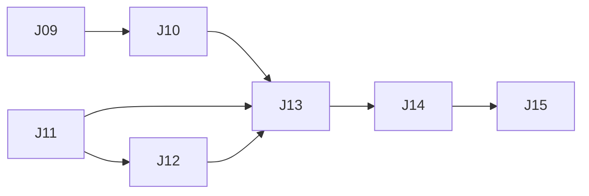

# Glance — Execution Plan

| | |
|---|---|
| Version | v6.0 |
| Date | 2026-10-29 |
| Inputs | [`product-spec.md`](product-spec.md) (v1.32) · [`tech-design.md`](tech-design.md) (v3.26) · design handoff v21 (`Kiosk display mockups.zip`, 2026-10-29) |
| Checks | `npm run check` → `npm run typecheck` → `npm test` → `npm run build` |

The backlog of open work. `/dooo` runs it top to bottom: it takes the first ⬜ row whose dependencies are ✅, does it in one PR, merges it and moves on until every row is ✅.

## Status tracking

| Status | Meaning |
|---|---|
| ⬜ Todo | Not started |
| 🔄 In progress ([#n](#)) | Work has started on its branch. Links the task's PR |
| ✅ Done ([#n](#)) | The task's PR is **merged to the default branch** |

**Rules**
- **Order** is the row order of the Tasks table. Put a task below everything it needs.
- A task is PR-sized (about 0.5–2 days of work), starts with a bold short title (`**Login form**: …`), and has a **Done when** check that can be verified (a test, a command, a page that matches a design).
- **IDs** are a letter and two digits (`A01`), one letter per batch of work. Never reuse an ID. Every letter A–Z is used, so a new batch reuses a letter and continues after its highest number (this batch: J, from J09).
- **Depends on** lists hard dependencies only, by ID, and only on rows still in this file, or `—`. A task can start once they are ✅. Two tasks that edit the same files (beyond the plan, docs and lockfile) also get a dependency, even without a logical one, so they never run at the same time.
- **Dependency map** (below the table) mirrors the Depends on column: a Mermaid graph and the parallel waves. Tasks in one wave have no path between them, so `/dooo` may run them at the same time. Update the map whenever a row or a dependency changes; the table wins if they disagree.
- One task = one branch (`feat/<ID>-<slug>`) and one PR titled `<ID>: <title>`. The PR's first commit sets the row to 🔄; its last commit before merge sets it to ✅. A closed, unmerged PR resets the row to ⬜.
- **Checks** (header) must all pass locally before the PR is marked ready, and CI (if the repo has any) must be green before merge.
- **Docs move with the code:** a PR that changes behavior, a decision, a schema, an API or the structure updates the spec and/or tech design in the same PR and fixes any row it makes wrong.
- Remove ✅ rows once nothing open depends on them.

**Owner decisions for v21** (2026-10-29 interview; they override the handoff where they differ, and the tasks below write them into the spec):
- **API key** reads and writes: `GET` (list, one), `POST`, `PATCH`, `DELETE` on `/api/v1/events` on the app's own host, `Authorization: Bearer glc_live_…`. The handoff's "can't read or list events" copy (Notes, Guide 08, the key panel) becomes read-and-write copy. Glance's event `id` is the handle: `POST` answers with it, `GET` lists it.
- **API reads** return events as stored (a weekly series is one item with `repeat` and `exdates`), filtered by optional `from` / `to` local dates.
- **API `who`** is an optional list of member names (ignoring case); missing = everyone; an unknown name is 400. API events remind like any other event.
- **API rate limit**: 60 requests a minute per key, then 429 with `Retry-After`.
- **Export events** is disabled offline ("Offline · needs a connection"), like Import and API key.
- **App version** is `package.json` `version`; every release bumps it.

## Tasks

| ID | Status | Task | Depends on | Done when | Covers |
|---|---|---|---|---|---|
| J09 | ⬜ | **Design handoff v21 in the repo, spec for v21**: copy the zip's `design_handoff_glance/` over `docs/design/handoff/`. Spec: new rows for Export events (SET-18), API key (SET-19), Refresh data (SET-20), Reload app (SET-21) and the public events API (API-01..), with the owner decisions above; SET-17 moves Import events from under Location to after "Hide sidebar when idle" (left card order: Location, Season, Background, Clock, Temperature, Notifications, Hide sidebar when idle, Import events, Export events, API key; no hairline under the last row). Move the Import row in Settings to match | — | `docs/design/handoff` matches the zip's `design_handoff_glance/` byte for byte; test `SET-17 Import events is the row after Hide sidebar when idle`; all Checks pass | §1, SET-17..21, API-* |
| J10 | ⬜ | **Export events**: pure `toIcs(events, people, now, tz)` in `src/domain` (iCalendar 2.0, CRLF, one VEVENT per event that hasn't ended (ongoing included), sorted by start, `UID:{id}@glance.app`, floating local DTSTART/DTEND in the screen's zone, all-day `VALUE=DATE`, SUMMARY/LOCATION/DESCRIPTION (notes + "For: {names}") escaped, weekly `RRULE:FREQ=WEEKLY` plus an `EXDATE` per skipped week). The Settings row: status "{n} upcoming events" / "No upcoming events" / "Saved {n} events · glance-events.ics" (role status), secondary "Download .ics" disabled with nothing upcoming or offline ("Offline · needs a connection"); downloads `glance-events.ics` | J09 | Tests: `SET-18` an ended event is left out and a running one kept; all-day → `VALUE=DATE`; a weekly series → one VEVENT with `RRULE` and its `EXDATE`s; commas, semicolons and line breaks are escaped; lines end in CRLF; the button is disabled with no upcoming events and offline; the row in `/dev/gallery` in four seasons; matches `Glance States - Settings` at the three sizes | SET-18 |
| J11 | ✅ ([#211](https://github.com/vespaiach/glance/pull/211)) | **API key service**: `api_keys` table (migration; one row per account: SHA-256 hash, last 4, `created_at`, `last_used_at`). `server/services/apiKeys`: `create` (409 if one exists; returns `glc_live_` + 32 base62 once), `get` (masked: tail, created, last used), `revoke`. Routes `GET/POST/DELETE /api/api-key` (session + Origin check on writes). Tech design: D40 (key format, hash only, one per account, read+write scope), §6.1 routes, §6.7 table | — | Tests: `SET-19` create returns a `glc_live_` + 32 base62 key and stores only its hash; a second create is 409; revoke removes it; `get` never returns the key; `tech§6.1` a cross-origin POST is rejected; another account's key can't be read or revoked | SET-19 |
| J12 | 🔄 ([#212](https://github.com/vespaiach/glance/pull/212)) | **Public events API**: `requireApiKey` guard (Bearer → account by hash, updates `last_used_at`, 401 otherwise) and a 60/min per-key limit (429 + `Retry-After`, reusing `server/auth/rateLimit`). `/api/v1/events`: `GET ?from&to` (stored events, series as one item), `POST`; `/api/v1/events/[id]`: `GET`, `PATCH` (partial), `DELETE` (tombstone). Valibot body: title, start, end?, allDay?, who? (member names), place?, notes?, repeat?, exdates?; limits as EVT-12. Writes go through the existing events service, so sync, push to screens and reminders work as usual. No Origin check (Bearer, no cookies). Tech design §6.8 API reference | J11 | Tests: `API-*` no or wrong key → 401; a revoked key → 401; POST creates an event that reaches `/api/sync` and answers its id; PATCH changes only the given fields; DELETE tombstones it; GET filters by from/to and returns a series once; an unknown `who` name → 400; a missing `who` → everyone; the 61st request in a minute → 429 with `Retry-After`; another account's event can't be read, changed or deleted through a key | API-* |
| J13 | ⬜ | **API key row**: pure component for SET-19 (No key: endpoint line "GET · POST · PATCH · DELETE {host}/api/v1/events", "Create key"; Created: block-1 panel "Copy this key now", full key in mono, Copy → "Copied" with check, Done; Has key: `glc_live_••••{tail} · {last used}`, Revoke → inline confirm "Apps using this key stop working right away." Cancel / Revoke key; Offline: Create and Revoke disabled, "Offline · needs a connection"), reducer `idle · creating · shown · asking`; connected to J11's routes. Copy as decided (read and write). Guide 08 "Import, export and API" with the read-and-write API text and "Import, Export and API key need a connection" | J10, J11, J12 | Tests: `SET-19` Create shows the key once and Done leaves only the masked key; Copy writes it to the clipboard; Revoke asks first and Cancel keeps the key; Create is hidden while a key exists; buttons disabled offline; every state in `/dev/gallery` in four seasons; matches `Glance States - Settings` at the three sizes; `GUIDE-*` section 08 shows | SET-19, GUIDE-01 |
| J14 | ⬜ | **Refresh data**: the "Data and app" card (right column, below Account) with its first row. A `refreshNow()` repo call asks the worker to push and pull now and refetches weather; state `idle · busy · done · fail` in a reducer. Status "Updated {n} min ago" from `lastSyncedAt`; tap → "Refreshing" (disabled, loader), "Getting the latest data"; success → "Updated just now" + check; failure → triangle-alert "Couldn’t reach the server. Try again.", data stays; taps while busy ignored; offline → disabled, "Offline · updated {n} min ago"; role status, aria-live polite | J13 | Tests: `SET-20` tap starts one sync and a second tap while busy doesn't; success shows "Updated just now"; a network failure shows the error and keeps the data; offline disables it; card in `/dev/gallery` in four seasons; matches `Glance States - Settings` D1–D4, D8 at the three sizes | SET-20 |
| J15 | ⬜ | **Reload app**: build exposes `package.json` `version`; public `GET /api/version` (no-store) answers the deployed one, read at the hourly update check. Row: "Version {x} · up to date", or when the server's is newer an accent dot, "Version {new} is ready · this screen runs {current}" and a primary button. Reload → inline confirm "The screen goes blank for a few seconds, then opens on Today." Cancel / Reload now → full-screen cover "Reloading Glance" with the version eyebrow, then `applyUpdate` (skipWaiting) or a cache-bypassing reload, opening on Today; sign-in, settings, drafts and the outbox stay. Offline: disabled, "Offline · needs a connection". Tech design D41 | J14 | Tests: `SET-21` a newer server version shows "Version {new} is ready" and the primary button; equal shows "up to date"; Reload asks first and Cancel does nothing; Reload now applies the waiting worker and lands on Today; disabled offline; `tech§6.1` `/api/version` answers `package.json`'s version; card in `/dev/gallery`; matches `Glance States - Settings` D5–D7 at the three sizes | SET-21 |

## Dependency map

| Wave | Tasks (run in parallel) |
|---|---|
| 1 | J09, J11 |
| 2 | J10, J12 |
| 3 | J13 |
| 4 | J14 |
| 5 | J15 |
