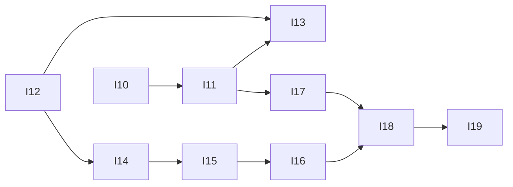

# Glance — Execution Plan

| | |
|---|---|
| Version | v5.0 |
| Date | 2026-10-29 |
| Inputs | [`product-spec.md`](product-spec.md) (v1.26) · [`tech-design.md`](tech-design.md) (v3.15) · design handoff v20 (`Kiosk display mockups.zip`, 2026-10-29) |
| Checks | `npm run check` → `npm run typecheck` → `npm test` → `npm run build` |

The backlog of open work. `/dooo` runs it top to bottom: it takes the first ⬜ row whose dependencies are ✅, does it in one PR, merges it and moves on until every row is ✅.

## Status tracking

| Status | Meaning |
|---|---|
| ⬜ Todo | Not started |
| 🔄 In progress ([#n](#)) | Work has started on its branch. Links the task's PR |
| ✅ Done ([#n](#)) | The task's PR is **merged to the default branch** |

**Rules**
- **Order** is the row order of the Tasks table. Put a task below everything it needs.
- A task is PR-sized (about 0.5–2 days of work), starts with a bold short title (`**Login form**: …`), and has a **Done when** check that can be verified (a test, a command, a page that matches a design).
- **IDs** are a letter and two digits (`A01`), one letter per batch of work. Never reuse an ID. Every letter A–Z is used, so a new batch reuses a letter and continues after its highest number (this batch: I, from I10).
- **Depends on** lists hard dependencies only, by ID, and only on rows still in this file, or `—`. A task can start once they are ✅.
- One task = one branch (`feat/<ID>-<slug>`) and one PR titled `<ID>: <title>`. The PR's first commit sets the row to 🔄; its last commit before merge sets it to ✅. A closed, unmerged PR resets the row to ⬜.
- **Checks** (header) must all pass locally before the PR is marked ready, and CI (if the repo has any) must be green before merge.
- **Docs move with the code:** a PR that changes behavior, a decision, a schema, an API or the structure updates the spec and/or tech design in the same PR and fixes any row it makes wrong.
- Remove ✅ rows once nothing open depends on them.

## Tasks

| ID | Status | Task | Depends on | Done when | Covers |
|---|---|---|---|---|---|
| I10 | ✅ ([#196](https://github.com/vespaiach/glance/pull/196)) | **Design handoff v20 in the repo, dim Strong**: copy the zip's `design_handoff_glance/` over `docs/design/handoff/` (the spec's IMP-* and tech design D39 already follow v20). Background dim default Light → Strong (0.4) for new accounts: `DEFAULT_SETTINGS`, BG-04 and the spec's Defaults line | — | `docs/design/handoff` matches the zip's `design_handoff_glance/` byte for byte; test `BG-04 a new account's dim is Strong`; all Checks pass | §1, BG-04 |
| I11 | ✅ ([#198](https://github.com/vespaiach/glance/pull/198)) | **Page top bar with Back**: one `PageTopBar` in `src/ui` (sticky at top 0, surface-soft, min 88 px, padding 12 × clamp(16, 3vw, 40) px, wraps, 1 px #e6e6e6 bottom border, full page width; 56 px canvas Back IconButton (`chevron-left`, "Back"), title clamp(22–28 px)/540, actions slot). The event page uses it in place of L02's glass capsule and × circle: Back does what × did ("Discard changes?" · Keep editing · Discard, Back hidden while asking); Delete/Edit at md, Save/Add another at lg; the page scrolls with the browser scrollbar. Remove the capsule styles, tokens and copy it leaves unused | I10 | `EVT-05` tests updated: Back (named "Back") closes, and with changes asks "Discard changes?"; `PageTopBar` in `/dev/gallery` in four seasons; the event page matches `Glance New Event` at 1920×1080, 1024×768 and 390×844 | EVT-05 |
| I12 | ✅ ([#199](https://github.com/vespaiach/glance/pull/199)) | **Weekly repeat: exception dates**: `CalendarEvent.exdates?: IsoDate[]` (local dates of skipped weeks) in the client and server schemas, the events table (migration), Dexie and sync. The occurrence expansion leaves those weeks out (Today, timeline, day list, week dots, Coming up, Ambient) and the reminder job and client next-reminder skip them. Docs: spec data model, tech design schema | — | Tests: `EVT-14` a series with an exception date doesn't show that week and shows the next; `NOTIF-*` no reminder for an excepted week; `tech§6.1` the schema accepts `exdates` and rejects a non-date; a server test that another account's series can't be read or written | EVT-14, NOTIF-01 |
| I13 | 🔄 | **This event or the series**: on a weekly event, Delete opens the dialog instead of the inline "Delete event" step, and Save opens it when anything changed (Glance Notes v20: 60% scrim, 520 px card, eyebrow "Repeats every {weekday}", titles and bodies as written, stacked "This event only" · "All events in the series" (danger on delete) · "Keep event" / "Keep editing"; scrim = cancel). Event details now open the tapped week, not the first. `one` delete adds that week's date to `exdates`; `one` save adds the exception plus a new one-time event with the changes (one outbox write each); `all` changes or deletes the series as today. Event page reducer gains the dialog step; all copy in `copy.ts` | I11, I12 | Tests: `EVT-14` deleting "This event only" hides only that week; saving "This event only" leaves the series and adds a one-time event on that date; "All events in the series" changes every week; the dialog doesn't open for one-time events or for Save with no changes; the dialog in `/dev/gallery` (delete and save); matches `Glance New Event` (dialog) at the three sizes | EVT-09, EVT-14 |
| I14 | ⬜ | **.ics parsing**: add `ical.js`. `parseIcs(text, now, tz)` in `server/services/imports/parse.ts` (D39) → `Result<{ events, range }, "not-ics" \| "no-upcoming">`, following IMP-05 and IMP-06: time zones, weekly-with-no-end → a series with `exdates`, other repeats expanded 12 months ahead (EXDATE, RECURRENCE-ID), multi-day split, ended events dropped, fields cut to 140/60/280, the 5 MB and 1,000-event caps. Pure, no database | I12 | Tests (fixture `.ics` files beside it): `IMP-05` a weekly no-end rule becomes one series with its EXDATEs; a monthly rule becomes one-time events for 12 months; a 3-day all-day event becomes 3; a timed event past midnight ends at midnight; a TZID event keeps its moment; a running event is kept and an ended one dropped; `IMP-06` a non-calendar file and 1,001 events are `not-ics`; only past events is `no-upcoming` | IMP-05, IMP-06 |
| I15 | ⬜ | **Import staging API**: the `imports` table (migration) and `server/services/imports`: `POST /api/imports` parses (I14), marks duplicates (IMP-07) against the account's events and series weeks and earlier rows of the file, stores the staged import and answers the review; `GET /api/imports/staged`. Staged rows older than an hour go in the hourly job. Transport methods + Valibot schemas (tech design §6.1, §6.7, D39) | I14 | Tests: `IMP-07` the review marks duplicates (same title ignoring case, start and end; a week of a series; a repeat within the file) and `newCount` excludes them; `IMP-06` a `.txt` → 400 `not-ics`, over 5 MB → 413; `tech§6.1` the route rejects a cross-origin POST; another account's import can't be read; `tech§6.4` the job removes stale staged rows | IMP-06, IMP-07 |
| I16 | ⬜ | **Import commit and Undo**: events gain `import_id` (migration; the client schema reads it, never writes it). `commit`, `last` and `undo` routes (§6.1, D39): commit writes the new events in one transaction with the picked who and notify on, marks the import done and announces once; undo tombstones every live event of the import within 24 h | I15 | Tests: `IMP-08` commit adds only the new events, with who and notify on, all or nothing; a second commit is 409; `IMP-10` undo removes edited ones too and nothing else; undo after 24 h is 409; `last` is only the newest; another account can't commit or undo; `NOTIF-01` an imported event reminds | IMP-08, IMP-10 |
| I17 | ⬜ | **Import events page (pure)**: `features/import/components` for IMP-02..IMP-09: Source (with and without a last import), Send from phone, Review, Importing, Imported and the three errors, inside `PageTopBar` with each step's actions; a reducer `step: source · phone · review · importing · done · error(type \| empty \| offline)`; slide in and out; scroll to top on each step. Copy in `copy.ts` | I11 | Tests: `IMP-*` reducer transitions (review → importing → done; importing offline → error → Try again → review; Change → source); "Import {n} events" / "Import 1 event", disabled while importing; Who is a single pick; the skip and done lines with 0, 1 and n; every frame in `/dev/gallery` in four seasons; matches `Glance States - Settings` I1–I7 at the three sizes | IMP-02..09 |
| I18 | ⬜ | **Import from this screen**: the SET-17 row and route `/settings/import` → `ImportScreen`, connecting I17 to the transport: Choose file uploads, Review commits, Imported → Open calendar / Undo import, Source's Undo tile from `last`, Back → Settings, offline at Import → the offline error. Guide text for import | I16, I17 | Tests: `SET-17` the row shows "Last: {date}" after an import; `IMP-*` picking a file shows its review; Import shows "{n} events added" and the events reach Calendar after sync; Undo removes them and closes; matches `Glance States - Settings` I1, I3, I4 in the real app at the three sizes | SET-17, IMP-01..10 |
| I19 | ⬜ | **Send from phone**: `POST /api/auth/qr { opens: "import" }` (10-minute link, `to=import`, §6.2); the phone opens `/settings/import` and its upload carries `forDisplay`; the waiting screen polls `GET /api/imports/staged` every 3 s and moves to Review when its file arrives; "New code" and 0:00 renew the code | I18 | Tests: `IMP-04` the import link lasts 10 minutes and opens Import; a phone upload for screen A moves A to its review and leaves screen B waiting; New code voids the old link; another account's upload never reaches this screen; matches `Glance States - Settings` I2 at the three sizes | IMP-04, SIGNIN-15 |

## Dependency map

| Wave | Tasks (run in parallel) |
|---|---|
| 1 | I10, I12 |
| 2 | I11, I14 |
| 3 | I13, I15, I17 |
| 4 | I16 |
| 5 | I18 |
| 6 | I19 |
