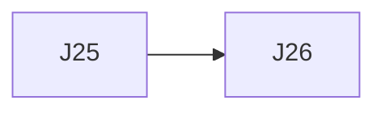

# Glance — Execution Plan

| | |
|---|---|
| Version | v1.0 |
| Date | 2026-11-01 |
| Inputs | [`product-spec.md`](product-spec.md) (v1.0) · [`tech-design.md`](tech-design.md) (v1.0) · design handoff v23 (`Kiosk display mockups.zip`, 2026-10-31) |
| Checks | `npm run check` → `npm run typecheck` → `npm test` → `npm run build` |

The backlog of open work. `/dooo` runs it top to bottom: it takes the first ⬜ row whose dependencies are ✅, does it in one PR, merges it and moves on until every row is ✅.

## Status tracking

| Status | Meaning |
|---|---|
| ⬜ Todo | Not started |
| 🔄 In progress ([#n](#)) | Work has started on its branch. Links the task's PR |
| ✅ Done ([#n](#)) | The task's PR is **merged to the default branch** |

**Rules**
- **Order** is the row order of the Tasks table. Put a task below everything it needs.
- A task is PR-sized (about 0.5–2 days of work), starts with a bold short title (`**Login form**: …`), and has a **Done when** check that can be verified (a test, a command, a page that matches a design).
- **IDs** are a letter and two digits (`A01`), one letter per batch of work. Never reuse an ID. Every letter A–Z is used, so a new batch reuses a letter and continues after its highest number (this batch: J, from J19).
- **Depends on** lists hard dependencies only, by ID, and only on rows still in this file, or `—`. A task can start once they are ✅. Two tasks that edit the same files (beyond the plan, docs and lockfile) also get a dependency, even without a logical one, so they never run at the same time.
- **Dependency map** (below the table) mirrors the Depends on column: a Mermaid graph and the parallel waves. Tasks in one wave have no path between them, so `/dooo` may run them at the same time. Update the map whenever a row or a dependency changes; the table wins if they disagree.
- One task = one branch (`feat/<ID>-<slug>`) and one PR titled `<ID>: <title>`. The PR's first commit sets the row to 🔄; its last commit before merge sets it to ✅. A closed, unmerged PR resets the row to ⬜.
- **Checks** (header) must all pass locally before the PR is marked ready, and CI (if the repo has any) must be green before merge.
- **Docs move with the code:** a PR that changes behavior, a decision, a schema, an API or the structure updates the spec and/or tech design in the same PR and fixes any row it makes wrong.
- Remove ✅ rows once nothing open depends on them.

## Tasks

| ID | Status | Task | Depends on | Done when | Covers |
|---|---|---|---|---|---|
| J25 | 🔄 | **Terms and Guide links on Sign in**: the two sentences under the lock footer become two links, "Terms" and "Guide", in one row pinned to the bottom-right corner on large and normal and at the end of the form on small (`account-layout`, Email form); each opens in a new tab with a 44 px hit target, in every form state. Update `copy.ts` | — | Component tests `SIGNIN-19 …` (both links present in every form state, `href` `/terms` and `/guide`, `target="_blank"`) pass; Sign in matches `account-layout` at the three sizes; Checks pass | SIGNIN-19 |
| J26 | ⬜ | **Terms of Service v2026-10-31**: `copy.ts` takes the handoff's terms (`terms-layout`): effective October 31, 2026, the demo and own-risk sections, contact support@takeaglance.app. Keep the three "How your data is stored" points and fix the Termination cross-reference to the new section numbers | J25 | Component test `TERMS-01 …` (effective date, contact email, Termination cross-reference) passes; `/terms` matches `terms-layout`; Checks pass | TERMS-01 |

## Dependency map

| Wave | Tasks (run in parallel) |
|---|---|
| 1 | J25 |
| 2 | J26 |
