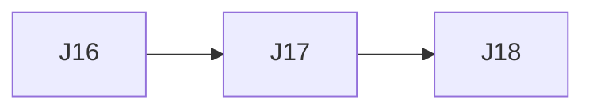

# Glance — Execution Plan

| | |
|---|---|
| Version | v6.1 |
| Date | 2026-10-29 |
| Inputs | [`product-spec.md`](product-spec.md) (v1.37) · [`tech-design.md`](tech-design.md) (v3.31) · design handoff v21 (`Kiosk display mockups.zip`, 2026-10-29) |
| Checks | `npm run check` → `npm run typecheck` → `npm test` → `npm run build` |

The backlog of open work. `/dooo` runs it top to bottom: it takes the first ⬜ row whose dependencies are ✅, does it in one PR, merges it and moves on until every row is ✅.

## Status tracking

| Status | Meaning |
|---|---|
| ⬜ Todo | Not started |
| 🔄 In progress ([#n](#)) | Work has started on its branch. Links the task's PR |
| ✅ Done ([#n](#)) | The task's PR is **merged to the default branch** |

**Rules**
- **Order** is the row order of the Tasks table. Put a task below everything it needs.
- A task is PR-sized (about 0.5–2 days of work), starts with a bold short title (`**Login form**: …`), and has a **Done when** check that can be verified (a test, a command, a page that matches a design).
- **IDs** are a letter and two digits (`A01`), one letter per batch of work. Never reuse an ID. Every letter A–Z is used, so a new batch reuses a letter and continues after its highest number (this batch: J, from J09).
- **Depends on** lists hard dependencies only, by ID, and only on rows still in this file, or `—`. A task can start once they are ✅. Two tasks that edit the same files (beyond the plan, docs and lockfile) also get a dependency, even without a logical one, so they never run at the same time.
- **Dependency map** (below the table) mirrors the Depends on column: a Mermaid graph and the parallel waves. Tasks in one wave have no path between them, so `/dooo` may run them at the same time. Update the map whenever a row or a dependency changes; the table wins if they disagree.
- One task = one branch (`feat/<ID>-<slug>`) and one PR titled `<ID>: <title>`. The PR's first commit sets the row to 🔄; its last commit before merge sets it to ✅. A closed, unmerged PR resets the row to ⬜.
- **Checks** (header) must all pass locally before the PR is marked ready, and CI (if the repo has any) must be green before merge.
- **Docs move with the code:** a PR that changes behavior, a decision, a schema, an API or the structure updates the spec and/or tech design in the same PR and fixes any row it makes wrong.
- Remove ✅ rows once nothing open depends on them.

**Owner decisions for v21** (2026-10-29 interview; they override the handoff where they differ, and the tasks below write them into the spec):
- **API key** reads and writes: `GET` (list, one), `POST`, `PATCH`, `DELETE` on `/api/v1/events` on the app's own host, `Authorization: Bearer glc_live_…`. The handoff's "can't read or list events" copy (Notes, Guide 08, the key panel) becomes read-and-write copy. Glance's event `id` is the handle: `POST` answers with it, `GET` lists it.
- **API reads** return events as stored (a weekly series is one item with `repeat` and `exdates`), filtered by optional `from` / `to` local dates.
- **API `who`** is an optional list of member names (ignoring case); missing = everyone; an unknown name is 400. API events remind like any other event.
- **API rate limit**: 60 requests a minute per key, then 429 with `Retry-After`.
- **Export events** is disabled offline ("Offline · needs a connection"), like Import and API key.
- **App version** is `package.json` `version`; every release bumps it.

## Tasks

| ID | Status | Task | Depends on | Done when | Covers |
|---|---|---|---|---|---|
| J16 | 🔄 ([#220](https://github.com/vespaiach/glance/pull/220)) | **Read ATTENDEE on import**: `parseIcs` reads each VEVENT's `ATTENDEE` display names (`CN`, trimmed; an attendee with no `CN` is skipped; `ORGANIZER` ignored) into an optional `attendees: string[]` on `ImportedEvent` (`domain/imports.ts`), distinct ignoring case, at most 20 per event, each cut to `EVENT_LIMITS.title`; every occurrence of an expanded repeat and each changed week keep their own VEVENT's names. Staged `parsed` JSON carries them; no migration (rows staged before this have none). Spec IMP-05 and tech-design D39 (version bump) updated | — | `parse.test.ts` tests named `IMP-05 …` against a new `fixtures/attendees.ics` (CN read, no-CN skipped, duplicates and cap, repeat occurrences keep names) pass; Checks pass | IMP-05, D39 |
| J17 | ⬜ | **Match attendees to people**: pure `attendeeTags(attendees, tags)` in `domain/imports.ts` (a name matches a live tag whose name is the same ignoring case and outer spaces, as FAM-04; returns the matched tag ids in tag order). Commit (`commit.ts`) gives an event with any match those tags (every tag → `everyone`, via `whoValue`), else the chosen who; unmatched names never create tags. The review (`stage.ts`) and the commit result add `matched` (new, non-duplicate events with a match), counted on read against live tags like duplicates and never stored. API table (§6.1) and D39 updated; spec IMP-07/IMP-08 updated | J16 | Tests `IMP-08 …` for `attendeeTags` (case, spaces, no match, every tag) and commit (matched event gets its tags, unmatched gets the chosen who, another account's tags never match) and `IMP-07 …` for `matched` in the review pass; Checks pass | IMP-07, IMP-08, D39 |
| J18 | ⬜ | **Show matches in Review and Imported**: `ReviewStep` adds "{m} matched to people in the file; the rest are for your pick." under the Who chips ("1 matched…"; left out with none) and `DoneStep` adds "{m} matched to people in the file." after "For {who} · …" (left out with none); copy in `src/copy.ts`, formatting in `importReview.ts`. Gallery `ImportGallery` shows Review and Imported with and without matches, in all four seasons | J17 | `importReview.test.ts` / `ImportPage.test.tsx` tests `IMP-07 …` / `IMP-09 …` (line shown with matches, singular, hidden with none) pass; gallery states match `Glance States - Settings` (frames I3, I4) at 1920×1080, 1024×768 and 390×844 (owner approves the new line, no design for it); Checks pass | IMP-07, IMP-09 |

## Dependency map

| Wave | Tasks (run in parallel) |
|---|---|
| 1 | J16 |
| 2 | J17 |
| 3 | J18 |
